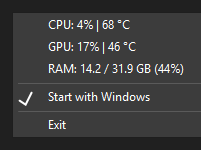

# EasyMonitoring

**A Windows tray monitor with an animated icon and current CPU, GPU, and RAM readings. It can start at logon without a UAC prompt.**

[](https://github.com/MiniBeary/EasyMonitoring/actions/workflows/build.yml)
[](https://github.com/MiniBeary/EasyMonitoring/releases)
[](LICENSE)
[](https://github.com/MiniBeary/EasyMonitoring/releases)
[](https://dotnet.microsoft.com/)

<p align="center">
  
</p>

EasyMonitoring runs only in the system tray and never opens a main window. The rotating arc speeds up with CPU load, and right-clicking the icon shows current CPU, GPU, and RAM readings.

> **Status:** `v1.0.1` is a maintenance release with architecture and behavior fixes. The app is unsigned, so Windows SmartScreen may show a warning.

## Download

1. Install the **PawnIO** driver (required for CPU temperature):
   ```powershell
   winget install --id namazso.PawnIO -e
   ```
2. Download `EasyMonitoring-win-x64.exe` from the [Releases](https://github.com/MiniBeary/EasyMonitoring/releases) page.
3. Run the exe and approve the UAC prompt. The app appears in the notification area.
4. To exit, right-click the icon and choose `Exit`.

The release also includes `SHA256SUMS.txt`. To verify the download:

```powershell
(Get-FileHash .\EasyMonitoring-win-x64.exe -Algorithm SHA256).Hash.ToLower()
Get-Content .\SHA256SUMS.txt
```

The hashes should match. The file is not signed with a certificate, so SmartScreen may warn you before it runs. That is expected for an open-source build.

## Features

- 5-frame rotating arc in the system tray.
- Animation speed follows average CPU load (2 to 20 FPS).
- Hover text: `CPU: 23% | 58 °C`.
- Right-click menu:
  - `CPU: 23% | 58 °C`
  - `GPU: 5% | 47 °C`
  - `RAM: 8.2 / 31.9 GB (26%)`
  - `Start with Windows`, which uses Task Scheduler;
  - `Exit`.
- Dark gray menu, white text (including disabled items), and a white check mark.
- Only one instance runs, and the app has no main window.
- No network access or telemetry. All measurements run locally.

## Autostart

Right-click the icon and select `Start with Windows`.

The app creates a Task Scheduler task named `EasyMonitoring` with `HighestAvailable` and `InteractiveToken`. On the next Windows sign-in, it starts in the tray without a UAC prompt. Clearing the check box deletes the task. If you move the exe, enable the check box again so the task points to the new path.

## Requirements

- Windows 10/11 x64.
- Administrator rights: the app requests UAC elevation to read sensors.
- **PawnIO**, the driver LibreHardwareMonitor uses to read CPU temperature:
  ```powershell
  winget install --id namazso.PawnIO -e
  ```
  Without PawnIO, CPU load, GPU, and RAM still work, but CPU temperature shows `N/A`.
- The .NET SDK 9 is only needed to build. The published exe is self-contained and does not require a .NET Runtime installation.

## Metric sources

| Metric | Source |
| --- | --- |
| CPU load | `GetSystemTimes` (P/Invoke) |
| CPU temperature | LibreHardwareMonitor 0.9.6 + PawnIO |
| GPU load/temperature | LibreHardwareMonitor, GPU Core |
| RAM | `GlobalMemoryStatusEx` |

CPU load does not use `PerformanceCounter` because counter names can differ on localized Windows.

## Resource usage

Idle measurements on this machine (Windows 11, Ryzen 9 5900X, Release build, averages over 5 minutes):

| Metric | EasyMonitoring | RunCat 365 3.6.0 |
| --- | --- | --- |
| CPU, % of one core | ~1.6 | ~8.2 |
| CPU, % total across 24 threads | ~0.066 | ~0.34 |
| Working set | ~85 MB | ~80 MB |
| Private bytes | ~39 MB | ~43 MB |
| Handles | ~411 | ~621 |
| GDI objects | 26 | 36 |
| Threads (peak) | 18 | 11 |
| Download size | 112 MB (single exe) | 141 MB (MSIX) |

RunCat 365 polls more sensor types and has settings. Numbers under load and on another machine will differ.

## Diagnostics

Three QA modes run without showing the tray icon and exit on their own:

```powershell
# Check CPU/GPU/RAM values
.\artifacts\publish\EasyMonitoring.exe --diagnostics

# Check tray UI objects: text, menu items, colors, animation frames
.\artifacts\publish\EasyMonitoring.exe --ui-check

# Check autostart: enable it, inspect the task XML, then disable it
.\artifacts\publish\EasyMonitoring.exe --autostart-check
```

Results are written to:

- `%LOCALAPPDATA%\EasyMonitoring\diagnostics.txt`
- `%LOCALAPPDATA%\EasyMonitoring\ui-diagnostics.txt`
- `%LOCALAPPDATA%\EasyMonitoring\autostart-diagnostics.txt`

`--autostart-check` temporarily creates the real `EasyMonitoring` task and removes it at the end. The other modes do not change anything.

Error log: `%LOCALAPPDATA%\EasyMonitoring\EasyMonitoring.log`.

## Build and tests

```powershell
dotnet test EasyMonitoring.sln -c Release
dotnet build EasyMonitoring.sln -c Release
```

## Publishing

Stop any running `EasyMonitoring.exe`, then:

```powershell
dotnet publish src/EasyMonitoring.App -c Release -r win-x64 --self-contained true `
  -p:PublishSingleFile=true `
  -p:IncludeNativeLibrariesForSelfExtract=true `
  -p:DebugType=None -p:DebugSymbols=false `
  -o artifacts/publish
```

Output: `artifacts/publish/EasyMonitoring.exe`.

## Architecture

- `MetricsSnapshotModule` in Core owns cadence, freshness, averages, and the missing-value policy. The App layer only polls the sources.
- `AutostartStateModule` owns the actual, desired, and unknown Task Scheduler state. The Windows adapter handles `schtasks` and the task XML.
- `SensorResolver` selects sensors by stable `SensorId`, and the LHM adapter binds them to live sensors once.
- `TrayApplicationContext` is the host and lifecycle. `TrayPresentationState` holds display state, and `TrayPresentation` is a thin WinForms adapter.
- See [CONTEXT.md](CONTEXT.md) for the domain vocabulary.

## Structure

```
src/EasyMonitoring.Core/   pure logic
src/EasyMonitoring.App/    Windows/LHM adapters and tray UI
tests/                     xUnit tests for Core and App
docs/                      plan, QA checklist, and notes
artifacts/publish/         published exe (not committed)
```

## Limitations

- Manual launches trigger a UAC prompt because the app manifest requires administrator rights. Autostart through Task Scheduler runs the task elevated without a separate UAC prompt.
- CPU temperature requires PawnIO. Without it, the app shows `N/A`.
- Available GPU sensors depend on the driver and LibreHardwareMonitor.
- `NotifyIcon.Text` may not update a tooltip that is already open. This is checked in QA.
- There are no user settings or theme selection. Autostart and the dark menu are built in.
- The exe is unsigned, so SmartScreen may warn.

## License

Project code is licensed under [MIT](LICENSE).

EasyMonitoring uses LibreHardwareMonitorLib 0.9.6 (MPL-2.0) and self-contained .NET 9. See [THIRD-PARTY-NOTICES.md](THIRD-PARTY-NOTICES.md) for details.
